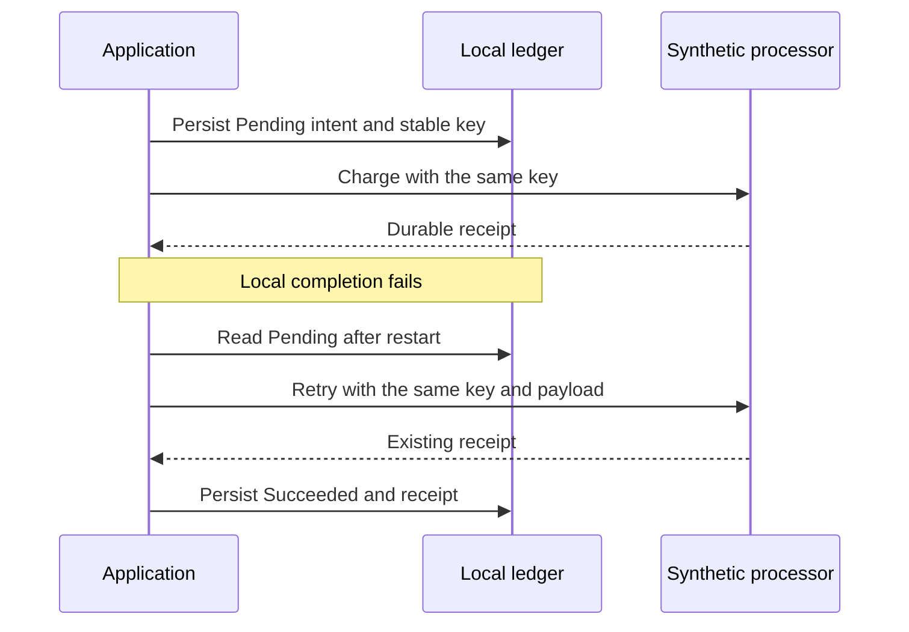

# Recoverable payment workflows in C#

A small independent portfolio demonstration of **durable intent, idempotency, and reconciliation** across two systems. It uses synthetic invoices and a fake processor. It contains no employer code, Stripe integration, or real payment credentials.

By [Bo Osinupebi](https://osinupebi.com/engineering), a Senior Software Engineer working with C#/.NET, Azure, SaaS APIs, and payment reliability.

## Run

Requires the [.NET 10 SDK](https://dotnet.microsoft.com/en-us/download/dotnet/10.0). There are no external package dependencies.

```sh
dotnet run
dotnet run -- --verify
```

The demonstration creates temporary files and removes them when finished. Verification exercises a committed processor action followed by local failure, restart recovery, repeated reconciliation, payload conflicts, invalid amounts, distinct payments, and concurrent retries through one service.

## The failure being modeled

An external action can succeed while the local success update fails. A database transaction cannot cover both systems. Persist enough local intent before calling the processor to identify and recover the payment later.



## Design choices

- **Amounts use integer minor units**, with an explicit currency.
- **Intent precedes the external action**, so an interrupted operation remains recoverable.
- **The key binds to the complete payload**. Reusing it for a different invoice, amount, or currency fails.
- **The processor stores idempotency independently**. Application restart does not reset the external receipt.
- **Retries reuse the original key**. Reconciliation repairs local state without a second charge.
- **Completed retries return the existing receipt**. They do not repeat the processor action.

The key identifies an operation, not an invoice. Two different keys can represent two different payments against the same invoice; invoice balance rules belong in the business model.

## Scope

JSON files keep the system boundary visible and make restart recovery easy to inspect. Atomic replacement and file flushing protect individual writes. The service serializes its own concurrent calls; it does not coordinate multiple processes or service instances. A production design would use transactional persistence, uniqueness constraints, worker coordination, real processor timeout/lookup semantics, and durable recovery scheduling. Declines, refunds, webhook ordering, authentication, and account scoping are outside this example.

This project is independent demonstration work. Its use of .NET 10 does not establish the framework versions used in my professional roles.

[Related payment systems note](https://osinupebi.com/thoughts/persist-intent-before-external-side-effects)
